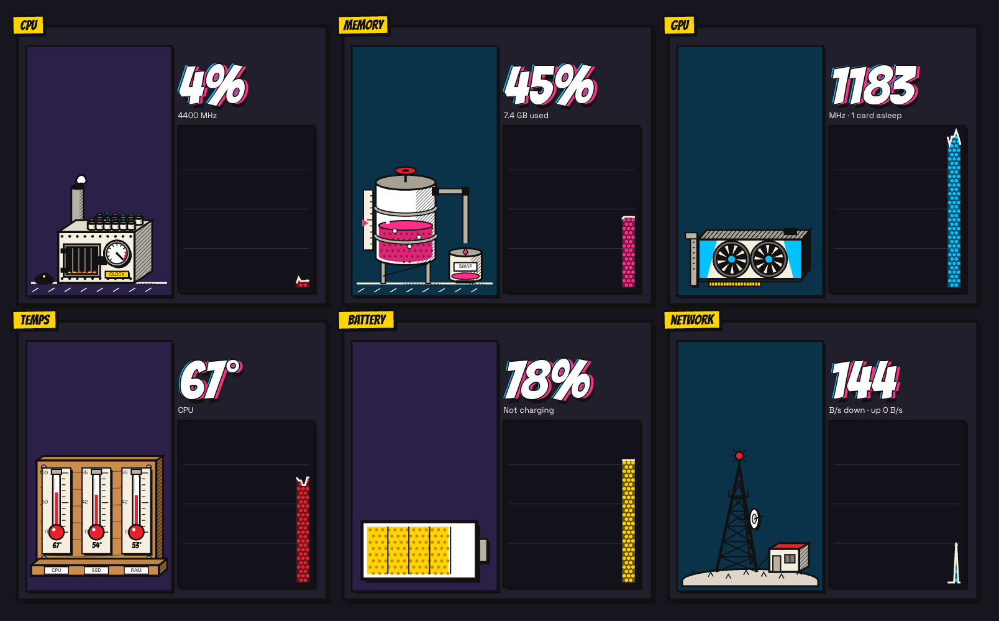
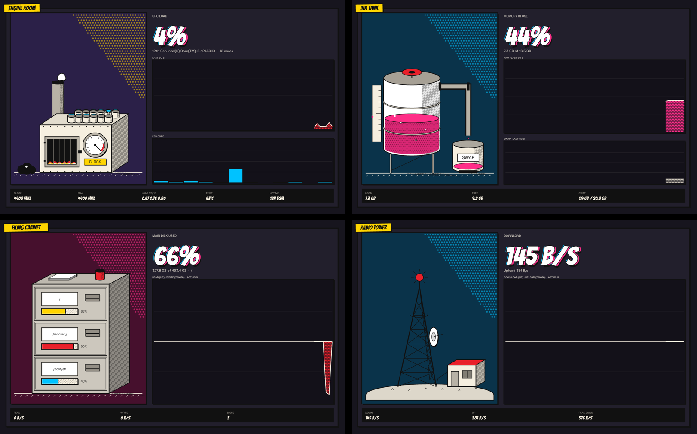
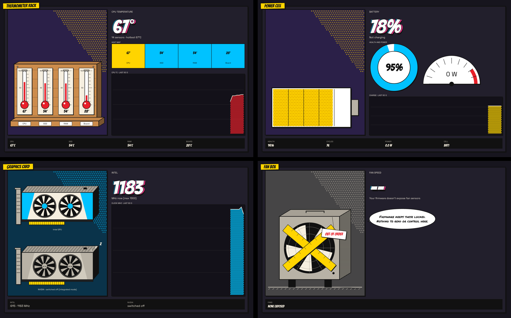

<p align="center"></p>

<h1 align="center">Ember</h1>

<p align="center">A comic-book system monitor and control center for the COSMIC desktop, written in Rust.</p>



Every reading is its own hand-drawn machine that moves with your system: a boiler whose
flames rise with CPU load, an ink tank that fills with memory, a radio tower that pulses with
traffic, a thermometer rack, a filing cabinet that opens its drawers while disks work. Charts
are printed with halftone dots; motion steps like animation drawn on twos.

| | |
|---|---|
|  |  |

## Features

- **Monitor**: CPU (per core, clock, load), memory and swap, disks (space and read/write),
  network, temperatures grouped by part, battery (health, cycles, power draw), every GPU
  including a switched-off one, fans. Last 60 seconds or the last hour.
- **Alerts**: notifications when CPU, memory or CPU temperature stay high, or the battery
  runs low, judged on a 10-second average so short spikes don't nag.
- **Control**: end, kill, pause or re-prioritize processes; start, stop, enable or disable
  systemd services; power profile, graphics mode and battery charge limit (system76-power);
  CPU governor, turbo and max performance; fans where the firmware allows it.
- **Apps**: every installed app from APT, Flatpak, Snap, AppImage, hand-made launchers,
  cargo, npm and bun, with icons. Uninstall with a button (APT removals are simulated first
  and system packages are refused), hide from the launcher, or copy the exact command.
- **Quick panel** and **COSMIC panel applets**: clock and calendar, sound, Bluetooth,
  network with Wi-Fi connect, power and brightness, Do Not Disturb, tiling, session menu,
  now playing, keep awake, and live readings.
- **Desktop widget**: a readings card under your windows, placed from Settings.
- Dark and light themes, a motion switch, and `--` instead of made-up numbers when
  something can't be read.

## Install

Pop!_OS 24.04 or Ubuntu 24.04 with COSMIC (other Debian-based COSMIC setups should work):

```sh
curl -fsSL https://raw.githubusercontent.com/n1th1n-19/ember/main/install.sh | bash
```

It asks which parts you want, shows what it will install, and asks before changing anything.
Every part is its own package, so take only what you need:

| Part | Package | What you get |
|---|---|---|
| `app` | `ember` | the Ember window; root helper `/usr/libexec/ember/ember-helper` (only via a polkit password prompt) |
| `service` | `ember-service` | `emberd`: one hour of history for the charts, and alerts |
| `widget` | `ember-widget` | the desktop widget |
| `readings` `clock` `sound` `bluetooth` `network` `power` `dnd` `tiling` `session` `media` `awake` | `ember-applet-<name>` | one COSMIC panel applet each (they share the `ember-applet` engine) |
| everything | `ember-full` | all of the above |

`ember-common` (icon, licenses, `ember-install`) comes with any part. Skip the questions
by naming parts:

```sh
curl -fsSL https://raw.githubusercontent.com/n1th1n-19/ember/main/install.sh | bash -s -- --only app,widget,sound,clock
```

Applets you install can go straight into your top panel. Ember's clock, sound, Bluetooth,
network, power, tiling and session take the place of COSMIC's; removing one puts COSMIC's
back. You can also do it yourself: `ember-applet --setup-panel sound,clock` and
`ember-applet --restore-panel sound,clock`, or from Ember's Settings.

### Update

```sh
curl -fsSL https://raw.githubusercontent.com/n1th1n-19/ember/main/install.sh | bash -s -- --update
```

Updates every installed Ember part, deletes files newer versions no longer use, and restarts
the service, widget and applets.

### Uninstall

```sh
curl -fsSL https://raw.githubusercontent.com/n1th1n-19/ember/main/install.sh | bash -s -- --uninstall
```

Removes everything Ember ever put on your machine: puts COSMIC's panel applets back,
un-hides launchers you hid with Ember, removes all Ember packages, your Ember settings,
history and caches, then lists anything it couldn't remove (normally nothing). Remove just
some parts with `--uninstall --only widget,sound`.

Once installed, `ember-install` does all of this offline: `ember-install --only service`,
`ember-install --update`, `ember-install --uninstall`. Add `--dry-run` to see what would
happen, or `--yes` to skip the questions.

## Permissions

Ember runs as you. Changes that need more go through the service that owns them and its
own password prompt: systemd, system76-power, NetworkManager, BlueZ, logind, and `apt` via
`pkexec` for uninstalls. The one root component, `ember-helper`, accepts six fixed commands
with validated arguments. See [SECURITY.md](SECURITY.md).

## Build from source

```sh
sudo apt install build-essential pkg-config libxkbcommon-dev libwayland-dev
cargo run -p ember
packaging/build-deb.sh          # builds every package into target/debs/
```

More in [CONTRIBUTING.md](CONTRIBUTING.md). The look is specified in [DESIGN.md](DESIGN.md).

## License

GPL-3.0-or-later. Fonts: Bangers and Space Grotesk (SIL OFL 1.1), Permanent Marker
(Apache 2.0); their licenses are in `res/fonts/`. Built on
[libcosmic](https://github.com/pop-os/libcosmic) (MPL-2.0).
